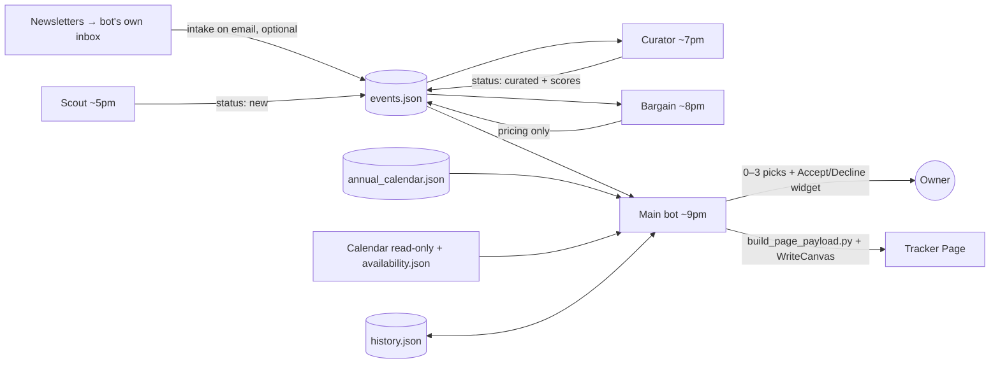

# Bay Area Event Kit

A data-free kit for rebuilding a Grok Bot **event recommender**: a main bot plus three teammates (Scout, Curator, Bargain) that find, score and price local events and send **0–3 picks a night** to accept or decline in chat. It also includes the exact five-tab **tracker Page** design.

The kit contains **no personal data**: no events, history, budget, calendar or availability contents, no names, email addresses or IDs. Each installation creates its own.

> Recommend only. Nothing here ever books, RSVPs, registers, buys, subscribes or messages anyone. Calendar access is **read-only** and limited to the main bot.

## Pipeline



## What's in the kit

| Path | What it is |
|---|---|
| `page/tracker.canvas.tsx` | The exact tracker Page design (Picks · Calendar · Save for later · History · Budget, plus detail drawer and help). It has an **empty** `PAGE_DATA` payload, so it shows empty states until you inject data. |
| `scripts/build_page_payload.py` | Builds `PAGE_DATA` from an events folder and splices it into the Page file. |
| `scripts/generate_schemas.py` | Writes the five JSON Schemas and empty `events/annual_calendar/history` files. It only creates missing files. |
| `scripts/jsonstore.py` | Shared-write helper with lock, re-read, merge by id, backup, validate and atomic replace. Has `append` and `patch --fields` commands. |
| `scripts/privacy_scan.sh` | Scans for personal data before you share anything. |
| `schemas/` | `events`, `history`, `annual_calendar`, `budget` and `availability` schemas (JSON Schema 2020-12). |
| `agents/` | `scout.md`, `curator.md`, `bargain.md`: CreateAgent description, SendToAgent briefing and full daily job for each. `main-bot.md`: the main bot's role. |
| `skills/` | `getting-started`, `event-data-setup`, `event-team-setup`, `event-ranking` and `event-tracker-page`. |
| `routines/` | Nightly picks and optional newsletter-intake routine prompts. |
| `examples/sf-bay-area/annual_calendar.example.json` | Public SF/Bay Area annual festival list with typical months and planning price ranges. Optional starting point only: re-verify before use. |
| `tests/` | `render_test.sh` type-checks and server-renders every tab. Fixtures are fictional. |

## Rebuild steps (for a new bot)

Run these on the bot's box. `EV=/workspace/events` is the data folder; use an instance-specific folder if another installation already uses it.

**1. Clone the kit** (HTTPS, no auth needed if the repo is public; otherwise use the owner's `gh auth login`):
```bash
git clone https://github.com/<kit-owner>/bay-area-event-kit.git /workspace/event-kit
# later: git -C /workspace/event-kit pull
```

**2. Onboard the owner.** Follow `skills/getting-started.md`: one question at a time covering city, interests, goals, budget, monthly cap, free windows, calendar (read-only), inbox, Page and team. Save the answers to `$EV/preferences.json`. Save runtime handles such as canvas id, agent ids and routine ids to `$EV/setup-state.json`. Never write secrets.

**3. Create the data folder and contracts:**
```bash
python3 -m pip install --user jsonschema   # or use a venv
python3 /workspace/event-kit/scripts/generate_schemas.py --dir "$EV"
```
Then write `budget.json` and `availability.json` from the owner's answers, using `schemas/` (unknown = `null`, never `0`). Also write `$EV/README.md` with the field contracts from `skills/event-data-setup.md`. Research the owner's own annual calendar. For the SF Bay Area you may start from `examples/sf-bay-area/annual_calendar.example.json`, but re-verify every entry.

**4. Create the team** (if the owner opts in). Follow `skills/event-team-setup.md` with `agents/*.md`:
- `CreateAgent` for Scout, Curator and Bargain, using the "CreateAgent description".
- `SendToAgent` with the briefing plus the **full** daily job pasted in. Each teammate then creates its own routine (5pm, 7pm, 8pm in the owner's zone).
- Copy the jobs to `$EV/workflow/{scout,curator,bargain}.md`, and `skills/event-ranking.md` to `$EV/workflow/event-ranking.md`.
- Record the new agent ids in `setup-state.json`.

Solo mode: the main bot runs all three jobs before ranking each night.

**5. First ranking pass now.** Follow `skills/event-ranking.md` and run Scout → Curator → Bargain → availability → rank. Real data only; zero picks is a valid result.

**6. Build the tracker Page:**
```bash
python3 /workspace/event-kit/scripts/build_page_payload.py --data-dir "$EV" \
  --page /workspace/event-kit/page/tracker.canvas.tsx --out "$EV/tracker.canvas.tsx" \
  --top-ids "<tonight's real pick ids, comma-separated, or omit>"
```
Read the canvas skill, then call `WriteCanvas` with the full contents of `$EV/tracker.canvas.tsx` (title e.g. "Event Tracker"). Store the returned canvas id in `setup-state.json`. On later nights, rebuild and overwrite the **same** Page; don't create a new one.

**7. Routines.** Save `routines/nightly-picks.md` (around 9pm in the owner's zone, every day) with `UpdateRoutine`. If the owner enabled the bot's own inbox, also save `routines/newsletter-intake.md` (triggered on email arrival). Reuse existing jobs rather than creating duplicates.

**8. Report honestly** what was actually created (Page link, teammates, routine times) and what is pending.

## How Page data injection works

`page/tracker.canvas.tsx` contains exactly one data statement between two marker lines:

```ts
// @@PAGE_DATA_START@@ ...
const PAGE_DATA:PageData = { preferences, as_of, events:[], annual:[], top_ids:[], history:{entries:[]}, budget:{...nulls} };
// @@PAGE_DATA_END@@
```

`build_page_payload.py` replaces only that line. Everything else (components, tabs, styles) stays identical. The `PageData`, `Event`, `Annual`, `HistoryEntry` and `Budget` types at the top of the file define the shape. Mapping from the canonical files:

- **events**: Only `curated/recommended/accepted/declined/attended` events that haven't ended, excluding past, cancelled and unverifiable ones. `price_min/max` becomes `lo/hi`. `type/tags` map to a Page category, or set `page_category` on the event. Card text comes from `page_short`/`page_why`, falling back to `scoring_rationale`. `pricing` passes through (best price, source, conditions, confidence, availability). Availability appears only as a safe label such as "Fits your free time" or "On-call day", never calendar titles.
- **annual**: Each annual record maps to `{name, date_start, timing, category, price range, price_basis, splurge/free flags, url}`.
- **top_ids**: Comes from `--top-ids`, then `setup-state.json` `top_ids`, then the latest `recommended` delivery in history. Max 3.
- **history**: The latest status per event, with spend taken from non-baseline transactions.
- **budget**: `budget.json`, where `budget_year_end_exclusive` is converted to an inclusive end date. Nulls render as "not set" or "Baseline needed", never as `$0` targets.

Check a built Page before writing it:
```bash
/workspace/event-kit/tests/render_test.sh "$EV/tracker.canvas.tsx"   # strict tsc + render all 5 tabs
```

## Shared-write rules (all bots)

- Prepare patches outside the lock. Then lock, re-read, merge by id preserving every other field, back up, validate, and atomically replace. `scripts/jsonstore.py` does all of this.
- Scout appends; Curator patches tags, verification and scores; Bargain writes `pricing` only (`jsonstore.py patch --fields pricing`). The main bot owns availability, final rank, history, budget and the Page.
- Never rerun seed scripts on live data, and never truncate a malformed file. Stop and report instead.

## Privacy checklist before sharing a fork

```bash
scripts/privacy_scan.sh . "<your name>" "<partner name>" "<home neighborhood>" "<budget figure>"
```
Keep `events.json`, `history.json`, `budget.json`, `availability.json`, `preferences.json` and `setup-state.json` out of git (see `.gitignore`).
